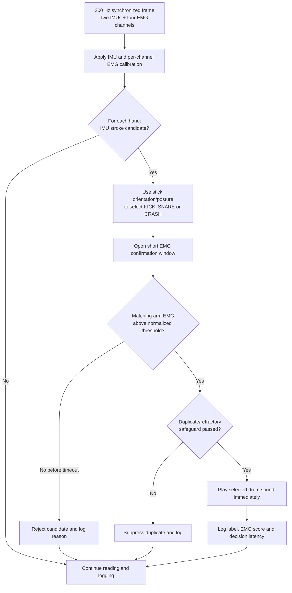

# MyoDrum daily implementation report — 12 October 2026

## Purpose

Today's work strengthened the synchronized dual-IMU and four-channel EMG
prototype, preserved the current rule-based baseline, and prepared a separate
workflow for collecting labelled machine-learning data.

## Implemented today

- Reorganized `mainMyoDrum` into a clear startup selection for IMU-only,
  EMG-only, four-channel IMU + EMG, the future six-channel interface, and
  classifier status.
- Kept the rule-based classifier as the only live four-channel classifier.
  Machine-learning collection is now deliberately separate and starts with
  `calibrateMachineLearningDataset` from the `calibration/` folder.
- Removed live plotting from the time-critical play path. Accepted audio is
  triggered before low-volume Command Window diagnostics are printed.
- Preserved independent left/right decisions and audio voices so both hands
  can trigger at nearly the same time, including simultaneous matching sounds.
- Improved EMG gain calibration so each channel uses only the active-reference
  movement from its own arm. This accounts for the four amplifiers having
  different gains.
- Added fail-closed EMG quality checks for missing active rise, poor
  signal-to-noise ratio, noisy rest signals, and amplifier/ADC saturation.
  Audio is not enabled when the EMG input is unsafe.
- Added runtime EMG rail detection and channel validity logging.
- Improved synchronized-stream timeout, backlog and measured-rate diagnostics.
- Added a labelled ML collector for balanced `NO_HIT`, `KICK`, `SNARE`, and
  `CRASH` blocks. The planned default is three rounds, two hands and 10 hits per
  hit class per round: 24 blocks and 180 labelled hit gestures in total.
- Added checkpointed raw data, block manifests, calibration captures and
  session metadata for later replay and investigation.
- Added or extended offline tests for interface routing, synchronized packet
  handling, hand-specific EMG calibration, unsafe EMG rejection and ML dataset
  packaging. The complete suite passes 70 of 70 tests.

## Rule-based classifier flow

The IMU proposes both the hit and drum label. EMG does not choose the drum; it
confirms that the movement was accompanied by intentional muscle activity.

## Key investigative findings

| Session | Evidence | Interpretation |
|---|---:|---|
| `session_20261012_165912` | 18,045 frames over 90.22 s at 200.00 Hz; 0 drops, 0 CRC failures and 0 parser resets | The synchronized acquisition path can operate reliably at the target rate. |
| `session_20261012_165912` | 82 IMU candidates: 60 accepted and 22 rejected; median decision latency 0 ms, 95th percentile 125 ms, maximum 125 ms | Most confirmations were immediate; delayed confirmations remained inside the EMG window. The 73.2% acceptance proportion is **not accuracy** because the session has no external ground-truth hit labels. |
| `session_20261012_175310` | 3,408 clean frames at 200.00 Hz, but all four EMG references were 0 V | Serial and IMU acquisition were healthy, while no EMG signal reached the ADC inputs. Collection correctly stopped before producing invalid training data. |
| `session_20261012_180432` | 5,816 clean frames at 200.00 Hz before a complete stream pause during the right reference | The ML collector needs recovery from an interrupted firmware stream; one automatic restart is now included. Hardware validation is still required. |
| `session_20261012_181659` | 1,003 rest frames and 2,404 active frames; raw ADC minimum and maximum were both zero on A0, A2, A3 and A4 | This failure occurred before rule-based classification. It indicates unpowered/disconnected EMG outputs, missing common ground, incorrect pin wiring, or unsuitable firmware—not a drum-classification error. |

## Investigation conclusions

1. Real-time synchronized acquisition at 200 Hz is feasible on the current
   MATLAB/Mega 2560 system when the hardware stream remains healthy.
2. The IMU + EMG decision path can make most accepted decisions immediately
   while retaining a short window for EMG arriving after the IMU candidate.
3. Current sessions demonstrate operation and timing, but do not yet establish
   classification accuracy. Accuracy requires known intended-hit labels and
   counts that are independent of the classifier output.
4. The latest failure is an EMG input-integrity problem. Rejecting zero-signal
   calibration prevents misleading demonstrations and unusable ML datasets.
5. ML data collection must remain separate from live play until a complete,
   correctly labelled dataset has been collected, trained and evaluated on
   held-out sessions.

## Objectives for tomorrow

1. Verify EMG power, the shared Mega/EMG ground, and A0/A2/A3/A4 output
   voltages with a multimeter before starting MATLAB.
2. Complete one EMG calibration in which every required channel has a nonzero
   active rise, acceptable signal-to-noise ratio and no saturation.
3. Record one complete 24-block ML dataset using
   `calibrateMachineLearningDataset`; do not train on interrupted or zero-EMG
   sessions.
4. Add an independent ground-truth protocol: requested hand, requested drum,
   intended hit count, unintended movement and missed/extra sound count.
5. Calculate confusion matrix, precision, recall, false-positive rate,
   false-negative rate and end-to-end latency from a held-out evaluation
   session.
6. Convert the rule-based flow above into the system-method section of the
   project poster, followed by a compact results panel using validated metrics.

